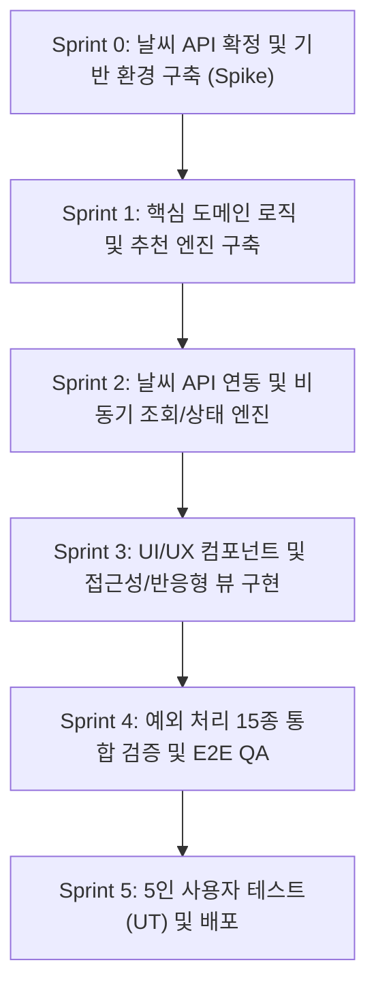

# 날씨 추천 앱 개발 계획서 (Development Plan)

> **문서 버전**: v1.0.0  
> **기준 문서**: 루트 `PRD.md` (날씨 추천 앱 PRD v1.0)  
> **문서 위치**: `docs/DEVELOPMENT_PLAN.md`  
> **작성일자**: 2026-11-20  

---

## 1. 개요 및 프로젝트 목표

### 1.1 프로젝트 개요
본 프로젝트는 **서울·광주·부산**에서 지금 외출을 준비하는 사용자를 위해, 사용자가 도시를 선택하면 현재 날씨와 단 1개의 맞춤 옷차림 추천 카드 및 명확한 추천 이유를 한 화면에서 직관적으로 제공하는 웹 서비스입니다.

### 1.2 핵심 가설
> *"현재 날씨에 맞는 구체적인 옷차림을 보여주면, 날씨 정보만 보여줄 때보다 외출 전 옷차림을 결정하는 데 도움이 된다."*

### 1.3 제품 원칙 및 가드레일 (엄격 준수)
1. **무회원·무결제·무광고**: 로그인, 계정, 결제, 제휴 광고 링크를 일체 배제한다.
2. **단일 화면 완결**: 별도 라우트 이동 없이 단일 뷰에서 선택, 조회, 추천 확인을 완결한다.
3. **엄격한 데이터 무결성**: 
   - 임의 가상 데이터나 예시 데이터를 정상 결과로 둔갑시키지 않는다.
   - 정보 기준 시각이 현재로부터 3시간을 초과하거나 미래 시각이면 추천에 사용하지 않는다.
   - 기온 누락 시 0℃로 대체하지 않고 추천을 중단한다.
4. **결정론적 추천 엔진**: 동일한 기온 및 강수 조건에는 언제나 동일한 추천 결과를 도출한다.
5. **투명성**: 날씨 제공 기관, 원문 링크, 정보 유형(관측 vs 모델), 기준 시각(KST), 서비스 편집 기준 안내를 반드시 명시한다.

---

## 2. PRD 요구사항 추적 매트릭스 (Traceability Matrix)

| 구분 | 요구사항 ID | 주요 내용 | 대응 스프린트 |
|---|---|---|---|
| **기능** | F-01 | 서울·광주·부산 도시 선택, 초기 미선택, 도시 변경 시 초기화 | Sprint 2, 3 |
| | F-02 | 날씨 제공처 확정 (무료 조건, 3개 도시, 정보 유형, 시각, 강수 규격) | Sprint 0 |
| | F-03 | 날씨 정보 필수/선택 스키마 정의 및 누락 구분 | Sprint 1 |
| | F-04 | 정보 유효성 (3시간 이내, 과거/미래 판정, 화면 체류 만료) | Sprint 1, 2 |
| | F-05 | 기본 옷차림 추천 (T-01 ~ T-07, 7개 구간 경계값 엄격 판정) | Sprint 1 |
| | F-06 | 강수 상태 5단계 판정 (비/눈/혼합/강수없음/확인불가) 및 추가 안내 | Sprint 1 |
| | F-07 | 정량 템플릿 기반 추천 이유 문장 생성기 | Sprint 1 |
| | F-08 | 조회/재조회, 10초 타임아웃, 중복 조회 방지, 순서 역전 방지 | Sprint 2 |
| | F-09 | 출처, 원문 링크(새 탭), 정보 유형, 기준 시각, 편집 기준 고지 | Sprint 3 |
| | F-10 | 제외 기능(계정, 결제, GPS, 음악/음식, AI채팅 등) 가드레일 | 전 스프린트 |
| **예외** | EX-01 | 도시 미선택 초기 상태 | Sprint 3 |
| | EX-02 | 연결 문제로 조회 실패 처리 및 재시도 | Sprint 2, 3 |
| | EX-03 | 10초 조회 지연(Timeout) 강제 중단 및 뒤늦은 응답 무시 | Sprint 2 |
| | EX-04 | 제공처 장애 / Rate Limit (429/503) 대응 | Sprint 2 |
| | EX-05 | 기온 누락 또는 파싱 실패 (0℃ 대체 금지) | Sprint 1, 2 |
| | EX-06 | 기준 시각 누락 또는 해석 불가 | Sprint 1, 2 |
| | EX-07 | 3시간 초과 오래된 정보 또는 미래 시각 정보 거부 | Sprint 1, 2 |
| | EX-08 | 강수량만 누락 (비·눈 안내 유지, 0mm 대체 금지) | Sprint 1, 3 |
| | EX-09 | 강수 여부 확인 불가 또는 정보 충돌 (기온 기반 추천 유지) | Sprint 1, 3 |
| | EX-10 | 날씨 상태 문구만 누락 ('상태 정보 없음' 표시, 정상 추천 유지) | Sprint 1, 3 |
| | EX-11 | 출처 또는 정보 유형 누락 시 정상 추천 차단 | Sprint 1, 2 |
| | EX-12 | 조회 중 도시 변경 시 이전 요청 취소 및 응답 순서 역전 방지 | Sprint 2 |
| | EX-13 | 조회 버튼 반복 클릭 방지 (중복 요청 차단) | Sprint 2, 3 |
| | EX-14 | 추천 콘텐츠 누락 방지 및 사전 완비성 검증 | Sprint 1, 4 |
| | EX-15 | 새로고침/재방문 시 상태 초기화 (캐시/스토리지 복원 금지) | Sprint 3 |
| **검증** | 6.1 | 기능 구현 완료 체크리스트 20개 항목 전수 통과 | Sprint 4 |
| | 6.2 | 사용자 검증(UT) 5인 테스트 및 80% 유용성/사용성 입증 | Sprint 5 |

---

## 3. 스프린트별 상세 실행 계획



---

### Sprint 0: 날씨 API 확정 및 기반 환경 구축 (기술 스파이크)

- **목표**: PRD F-02 조건을 완벽하게 충족하는 공식 날씨 데이터 제공처를 조사·확정하고, Next.js 기반 테스트 및 개발 환경을 구축한다.
- **기간 (예상)**: 2~3일

#### 세부 태스크 (Tasks)
1. **[F-02] 날씨 제공처 후보 기술 스파이크 및 비교 분석**
   - **후보 1**: 기상청 단기예보(초단기실황) 오픈API (공공데이터포털)
     - 장점: 대한민국 국가지정 관측 자료, 관측 지점 명확 (서울/광주/부산)
     - 점검 사항: 실시간 관측 시각 지연 여부, 강수 형태(PTY) 코드 정의, 트래픽 한도
   - **후보 2**: Open-Meteo (또는 대체 글로벌 기상 API)
     - 장점: 별도 키 없이 상업/비상업 무료, 안정적인 지연 시간, CORS 제약 없음
     - 점검 사항: 모델 기반 현재 날씨(WMO 코드) 유효성, KST 기준 시각 변환 정확도
   - **산출물 작성**: `docs/WEATHER_API_SPEC.md`에 이용조건, 지원 도시 좌표, 정보 유형, 기준 시각, 강수 규격, 필수 표기 출처 명시
2. **프로젝트 환경 셋업 및 테스트 프레임워크 구축**
   - 단위 테스트 환경 구성: `vitest` 및 `@testing-library/react` 설정
   - 도메인/유틸/컴포넌트 디렉토리 구조 확립
   - 코드 컨벤션, TypeScript Strict 모드 설정 점검

#### 완료 기준 (DoD)
- [x] `docs/WEATHER_API_SPEC.md`에 서울·광주·부산 3개 도시 연동 규격서 작성 완료
- [x] 테스트 러너(`pnpm test`) 실행 성공 확인 (Vitest 환경 구성 및 30개 단위 테스트 통과)

---

### Sprint 1: 핵심 도메인 로직 및 추천 엔진 구축

- **목표**: 외부 환경에 의존하지 않는 순수 함수 형태의 날씨 유효성 검증기 및 옷차림 추천 엔진을 개발하고, 100% 단위 테스트 커버리지를 확보한다.
- **관련 요구사항**: F-03, F-04, F-05, F-06, F-07, EX-05 ~ EX-10, EX-14
- **기간 (예상)**: 3~4일

#### 세부 태스크 (Tasks)
1. **[F-03, F-04] 날씨 데이터 스키마 및 유효성 검증 엔진 (`lib/weather/validator.ts`)**
   - 필수 항목 검증: 도시, 기온(숫자), 기준 시각(ISO/KST), 출처 정보, 정보 유형
   - 시각 유효성 규칙:
     - 기준 시각 > 현재 시각 (미래 시각 거부 -> `EX-07`)
     - (현재 시각 - 기준 시각) > 3시간 (초과 시 거부, 정확히 3시간은 허용 -> `EX-07`)
   - 기온 유효성 규칙: `null`, `undefined`, `NaN` 거부 (0℃ 대체 금지 -> `EX-05`)
   - 날씨 상태/강수량 누락 처리: 선택 항목으로 격하하되 상태 플래그 유지 (`EX-08`, `EX-10`)
2. **[F-05] 기온 구간별 기본 옷차림 매퍼 (`lib/recommendation/outfit-rules.ts`)**
   - 7개 기온 구간 엄격 분기:
     - `temp < 0`: T-01 "두꺼운 외투와 보온용품"
     - `0 <= temp < 5`: T-02 "두꺼운 외투와 니트"
     - `5 <= temp < 10`: T-03 "코트와 긴소매"
     - `10 <= temp < 15`: T-04 "재킷과 긴소매"
     - `15 <= temp < 20`: T-05 "얇은 겉옷과 긴소매"
     - `20 <= temp < 28`: T-06 "얇은 상의와 가벼운 하의"
     - `temp >= 28`: T-07 "통풍이 잘되는 가벼운 옷"
   - 경계값 테스트: `-0.1`, `0.0`, `4.9`, `5.0`, `9.9`, `10.0`, `14.9`, `15.0`, `19.9`, `20.0`, `27.9`, `28.0`
3. **[F-06] 강수 상태 판정 엔진 (`lib/recommendation/precipitation.ts`)**
   - 판정 우선순위 5단계:
     1. 강수 유형 정보(비/눈/혼합) 유효성
     2. 날씨 상태 문자열에서 명확한 비/눈/혼합 식별
     3. 명확한 강수 없음(None) 식별
     4. 정보 없음/해석 불가 시 `UNKNOWN` 처리
     5. 정보 충돌 시 `UNKNOWN` 처리
   - 추가 안내 문구 매핑:
     - 비: *"우산과 방수 신발도 함께 준비해 보세요."*
     - 눈: *"방수와 미끄럼 방지를 고려한 신발을 준비해 보세요."*
     - 혼합: *"우산과 함께 방수·미끄럼 방지를 고려한 신발을 함께 준비해 보세요."*
     - 강수 없음: 추가 안내 없음
     - 확인 불가: *"강수 여부를 확인할 수 없어 기온만 기준으로 추천했어요."*
4. **[F-07] 추천 이유 문장 생성기 (`lib/recommendation/reason-generator.ts`)**
   - PRD 정의 템플릿 엄격 치환 (비, 눈, 혼합, 강수 없음, 확인 불가)
   - 개인화 수식어 배제 및 날씨 제공 기관이 추천한 것 같은 오인 표현 방지
5. **[EX-14] 추천 콘텐츠 완비성 검증 테스트**
   - 임의 실수 기온(-50℃ ~ 50℃) 전수 구간 누락 검사

#### 완료 기준 (DoD)
- [x] 도메인 로직 및 추천 엔진 단위 테스트 케이스 30개 이상 작성 및 통과 (30/30 통과)
- [x] 기온 경계값 및 5가지 강수 조건에 대한 결정론적 결과 검증 완료 (EX-14 완비성 검증 통과)

---

### Sprint 2: 날씨 API 연동 및 비동기 조회/상태 엔진

- **목표**: 서버사이드 API 프록시를 구축하고, 네트워크 지연·타임아웃·경쟁 상태(Race Condition)를 안전하게 제어하는 비동기 데이터 훅을 개발한다.
- **관련 요구사항**: F-01, F-08, EX-02, EX-03, EX-04, EX-06, EX-11, EX-12, EX-13
- **기간 (예상)**: 3~4일

#### 세부 태스크 (Tasks)
1. **[F-01, F-08] Next.js Route Handler (`app/api/weather/route.ts`)**
   - 클라이언트 요청 파라미터(`city`: seoul, gwangju, busan) 수신 및 유효성 검사
   - 외부 기상 API 호출 및 표준 DTO 변환
   - 10초 타임아웃 서버 제어 (Server Timeout Fallback)
   - 제공처 장애(5xx) 및 Rate Limit(429) 감지 시 정형화된 에러 응답 반환 (`EX-04`)
2. **[F-08, EX-03, EX-12, EX-13] 비동기 데이터 패칭 훅 (`hooks/useWeatherRecommendation.ts`)**
   - **AbortController 적용**: 새 도시 선택 시 진행 중인 직전 요청 즉시 Abort
   - **Request ID / Sequence 관리**: 이전 도시 응답이 늦게 오더라도 현재 선택 도시와 일치하지 않으면 폐기 (`EX-12`)
   - **10초 클라이언트 타임아웃 (`EX-03`)**: 10초 초과 시 로딩 강제 종료 후 지연 오류 화면으로 전환
   - **중복 요청 방지 (`EX-13`)**: 조회 중('loading') 상태일 때 동일 도시 재클릭 차단
   - **단일 도시 변경 허용**: 조회 중에도 다른 도시 클릭 시 즉시 전환
3. **[F-04, EX-07] 화면 체류 중 정보 만료 감지 타이머**
   - 정상 조회 후 화면을 켜둔 상태에서 3시간이 경과하면 자동으로 추천 카드를 숨기고 만료 안내 및 재확인 유도

#### 완료 기준 (DoD)
- [ ] Mock 서버를 통해 10초 초과 지연 시 정상 타임아웃 처리 확인
- [ ] 서울 클릭 직후 부산 클릭 시 부산 결과만 최종 반영되는 Race Condition 방지 검증
- [ ] Rate Limit (429) 발생 시 재시도 제한 로직 동작 확인

---

### Sprint 3: UI/UX 컴포넌트 및 접근성/반응형 뷰 구현

- **목표**: PRD 제3절의 화면 명세와 8가지 화면 상태를 충실히 구현하고, 모바일 반응형 및 키보드 웹 접근성을 완비한다.
- **관련 요구사항**: 제3절 화면 명세 전반, F-09, EX-01, EX-15
- **기간 (예상)**: 3~4일

#### 세부 태스크 (Tasks)
1. **[3.1, 3.2] 단일 화면 구조 및 8가지 화면 상태 머신 구현**
   - 상태 정의:
     1. `INITIAL`: 초기 상태 (도시 미선택, 안내 문구 표시, `EX-01`)
     2. `LOADING`: 조회 중 ("날씨를 확인하고 있어요", 스피너)
     3. `SUCCESS`: 정상 결과 (날씨 요약 + 추천 카드 + 출처)
     4. `PARTIAL`: 일부 정보 누락 (기온 기반 추천 + 누락 안내 + 출처)
     5. `ERROR_NETWORK`: 연결 문제로 조회 실패 (`EX-02`)
     6. `ERROR_TIMEOUT`: 10초 지연 실패 (`EX-03`)
     7. `ERROR_RATE_LIMIT`: 제공처 장애/한도 초과 (`EX-04`)
     8. `EXPIRED`: 정보 만료 상태 (`EX-07`)
2. **컴포넌트 개발 (`components/`)**
   - `HeaderSection`: 서비스 소개 ("지금 외출할 때 입을 옷을 골라보세요")
   - `CitySelector`: 서울·광주·부산 선택 버튼 그룹 (조회 중 동일 도시 비활성화, 포커스 링)
   - `WeatherSummary`: 도시, 기온(℃), 날씨/강수 상태, 기준 시각(KST), 정보 유형
   - `RecommendationCard`:
     - 제목: '지금 참고할 옷차림'
     - 기본 옷차림
     - 강수 대비 추가 안내 (해당 시)
     - 추천 이유 문장
     - 고정 안내문: *"현재 날씨 기준의 참고용 추천입니다. 이후 날씨와 개인의 체감 차이는 반영하지 않습니다."*
   - `SourceFooter`: 제공 기관명, 원문 링크(`target="_blank"`, `rel="noopener noreferrer"`), 기준 시각, 편집 기준 안내
3. **[F-09, EX-15] 무상태성 및 새로고침 대응**
   - `localStorage`나 URL 파라미터에 도시를 저장하지 않음
   - 브라우저 새로고침(F5) 시 무조건 초기 상태(`INITIAL`)로 복귀 (`EX-15`)
4. **반응형 디자인 및 웹 접근성 (A11y)**
   - 모바일(320px 이상) 환경에서 가로 스크롤 완전 배제
   - 키보드 Tab 및 Enter/Space 키로 도시 선택, 재조회, 출처 링크 열기 가능
   - 색상 외에 아이콘 및 명확한 텍스트 문구로 상태 구분

#### 완료 기준 (DoD)
- [ ] 8가지 화면 상태가 Figma/PRD 명세대로 렌더링 확인
- [ ] 모바일(360px viewport) 및 데스크톱 브라우저에서 반응형 레이아웃 검증
- [ ] 마우스 없이 키보드만으로 전 흐름 탐색 가능 확인

---

### Sprint 4: 예외 처리 15종 통합 검증 및 E2E QA

- **목표**: PRD 5절의 예외 처리(EX-01 ~ EX-15)와 6.1 구현 완료 조건을 100% 검증하고 버그를 해결한다.
- **기간 (예상)**: 3일

#### 세부 태스크 (Tasks)
1. **[PRD 5절] EX-01 ~ EX-15 시나리오별 E2E/통합 테스트 스위트 작성**
   - `EX-01`: 첫 진입 시 임의 도시 선택 없음 및 결과 영역 미노출
   - `EX-02`: API 단절/네트워크 에러 시 복구 버튼 및 안내 문구 확인
   - `EX-03`: 10초 응답 지연 발생 시 타임아웃 안내 및 재시도 확인
   - `EX-04`: 429 Too Many Requests 모의 응답 시 자동 반복 요청 차단 확인
   - `EX-05`: 기온 필드 누락 시 추천 차단 및 오류 메시지 확인
   - `EX-06`: 기준 시각 누락 시 현재 시각으로 임의 대체하지 않는지 확인
   - `EX-07`: 3시간 1분 전 데이터 주입 시 거부 및 만료 화면 표출 확인
   - `EX-08`: 강수량 null 주입 시 '강수량 정보 없음' 표기 및 비 안내 유지 확인
   - `EX-09`: 강수 여부 불명확 시 기온 기반 추천 및 안내 문구 확인
   - `EX-10`: 날씨 텍스트 누락 시 '상태 정보 없음' 표기 및 추천 유지 확인
   - `EX-11`: 출처 필드 누락 시 정상 추천 차단 확인
   - `EX-12`: 서울 요청 후 100ms 뒤 부산 클릭 시 부산 결과만 표출 확인
   - `EX-13`: 재확인 버튼 5회 연속 광클 시 단 1회만 네트워크 호출 확인
   - `EX-14`: 전체 온도 구간에 빈 추천 없는지 전수 확인
   - `EX-15`: 결과 화면에서 새로고침 시 초기 화면 복귀 확인
2. **[PRD 6.1] 구현 완료 체크리스트 20개 항목 전수 실사 및 체크**

#### 완료 기준 (DoD)
- [ ] PRD 6.1의 20개 구현 체크박스 전수 체크 완료
- [ ] 회귀 테스트 및 E2E 테스트 전체 통과

---

### Sprint 5: 사용자 검증(UT) 프로토콜 실행 및 제품 릴리즈

- **목표**: PRD 6.2의 사용자 테스트 가이드라인에 따라 5명의 실사용자 검증을 수행하고, 성공조건을 정량 측정하여 개선사항을 도출한 뒤 정식 릴리즈한다.
- **기간 (예상)**: 3~4일

#### 세부 태스크 (Tasks)
1. **[PRD 6.2] 사용자 검증 테스트 계획서 및 기록 시트 작성 (`docs/USER_TESTING_PROTOCOL.md`)**
   - 참여자 5명 모집 (서울·광주·부산 외출 준비자 대상)
   - 테스트 절차:
     1. 사전 설명 없이 도시 선택부터 추천 확인까지 소요 시간 측정 (목표: 60초 이내)
     2. 날씨 정보만 먼저 보여준 후 예상 옷차림 질문
     3. 추천 카드 노출 후 3가지 정형 질문 인터뷰:
        - "옷차림을 결정하는 데 도움이 됐나요?"
        - "어떤 내용이 도움이 됐거나 부족했나요?"
        - "오늘 실제로 참고하겠나요? 그 이유는 무엇인가요?"
2. **정량/정성 데이터 취합 및 성공조건 평가**
   - 사용성 목표: 5명 중 4명 이상(80%) 60초 이내 완료 여부 판정
   - 유용성 목표: 5명 중 4명 이상(80%) 도움 여부 및 구체적 이유 회신 판정
   - 한계점 기록: 사전 날씨 노출에 따른 편향 및 소규모 표본 한계 명시
3. **프로덕션 배포 및 최종 문서화**
   - Vercel 프로덕션 배포
   - PRD 6.2 완료 조건 체크 완료
   - 최종 결과 보고서 작성 (`docs/UT_RESULT_REPORT.md`)

#### 완료 기준 (DoD)
- [ ] 사용자 테스트 5인 완료 및 결과 보고서 작성
- [ ] 프로덕션 배포 완료 및 라이브 URL 정상 동작 검증

---

## 4. 품질 관리 및 완료 정의 (Definition of Done)

모든 스프린트는 다음 기준을 만족해야 완료(Done)로 판정합니다.

1. **빌드 및 타입 체크**: `pnpm build` 시 TypeScript 및 Lint 에러 0건.
2. **테스트 통과**: 해당 스프린트에서 작성된 모든 단위/통합 테스트 통과 (`pnpm test`).
3. **PRD 정합성**: PRD의 명시적 문구, 예외 처리, 화면 상태와 100% 일치.
4. **가드레일 준수**: 로그인, 결제, GPS 수집, 임의 데이터 생성 등 제외 기능이 포함되지 않음을 코드 리뷰로 확인.

---

## 5. 문서 및 산출물 관리 체계

`docs/` 폴더 내에 다음과 같이 개발 및 검증 문서를 단계별로 생성하여 관리합니다.

```
docs/
├── DEVELOPMENT_PLAN.md        # [본 문서] 전체 개발 계획 및 스프린트 로드맵
├── WEATHER_API_SPEC.md        # [Sprint 0] 날씨 제공처 확정 및 데이터 매핑 규격서
├── TEST_SPECIFICATION.md      # [Sprint 4] EX-01~EX-15 테스트 시나리오 및 매트릭스
├── USER_TESTING_PROTOCOL.md   # [Sprint 5] 사용자 테스트(UT) 진행 가이드 및 설문지
└── UT_RESULT_REPORT.md        # [Sprint 5] 5인 UT 수행 결과 및 회고 보고서
```
